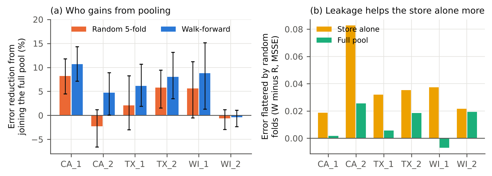

# Who Earns Credit in a Forecasting Pool?
**Source-Level Shapley Values, Core Stability, and Deployment-Faithful Validation**

**Paper (PDF):** [Khan_2026_Who_Earns_Credit_in_a_Forecasting_Pool.pdf](Khan_2026_Who_Earns_Credit_in_a_Forecasting_Pool.pdf)

Ten Walmart stores from the M5 data act as ten firms of different sizes pooling sales histories into one demand forecaster. For all 1,023 coalitions, the study measures each member's out-of-sample error under **random 5-fold** and **walk-forward** validation (same 117 evaluation weeks), then computes exact Shapley values, the core and least core, bootstrap intervals, quarterly drift and cheap estimators.

## Key results

| | Random 5-fold | Walk-forward |
|---|---|---|
| Pool value, LightGBM (6 stores) | 0.147 | 0.310 |
| Average store gain from pooling | 3.1% | 6.3% |
| Core non-empty (LightGBM) | no | yes |

- Random folds understate the pool's value in all five games: leaked future rows help a store's standalone model about 3.5 times more than the pooled model.
- The protocol changes who counts as a contributor: some store's Shapley value flips sign in four of five games.
- Shapley is outside the core in all ten game-protocol pairs; the core is empty in nine.
- Monte Carlo Shapley with 200 permutations matches the exact ranking (Kendall tau >= 0.95); leave-one-out misstates magnitudes by 25% to 66%.

## Reproduce
Open `M5_Shapley_Pool_Study.ipynb` in Colab (CPU is enough) and run all, about 15 to 20 minutes. Scripts: `scripts/pool_games.py` (coalition games), `scripts/analyze.py` (Shapley, core, bootstrap, drift, estimators), `scripts/figs.py` (figures). `results/games.npz` holds every coalition's per-store, per-week errors.

Author: Muhammad Imad Khan, GIKI.
